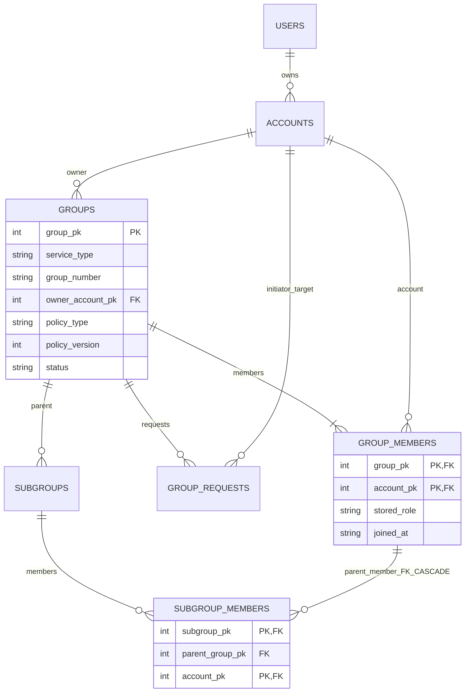

# 数据库 v3：群组增量迁移

入口是 `DatabaseDXX`；SQL 为 `database/migrations/003_groups.sql`，构建时嵌入服务器。空库按 v1→v2→v3 初始化；已有 v1/v2 库先 SQLite backup、quick_check，生成原路径加 `.v1-backup.sqlite3` 或 `.v2-backup.sqlite3`（重名追加序号），然后依序升级。v3 不重复迁移；未知非空库/未来版本拒绝启动。迁移完成检查 foreign_key_check；未触碰原用户、账号、好友、绑定、注册/变更幂等记录。

| 表 | 主键/主要约束 | 用途 |
|---|---|---|
| group_counters | service_type=QQ/WECHAT，next_value>0 | 两平台群号分别从1001事务分配 |
| groups | group_pk；UNIQUE(service_type,group_number) | 原平台、群名、owner、策略及版本、公告、ACTIVE/DISBANDED |
| group_members | PK(group_pk,account_pk)；单群唯一OWNER | OWNER/ADMIN/MEMBER保存角色及加入时间 |
| group_requests | request_pk；同群同target仅一个PENDING | APPLY/INVITE；参与者、处理状态/时间 |
| subgroups | subgroup_pk；UNIQUE(subgroup_pk,parent_group_pk) | 唯一父群、创建者、状态/时间 |
| subgroup_members | PK(subgroup_pk,account_pk) | 独立子群成员集合及parent_group_pk |

群表 owner 到群成员的复合 FK 为 DEFERRABLE INITIALLY DEFERRED：创建群和OWNER在同一事务写入，提交时不允许无主群。触发器检查原属服务ACTIVE账号、OWNER身份一致性与不可转让、群标识不可改变、请求流程合法、终态不可复活、QQ策略下才能新增子群。`subgroup_members(parent_group_pk,account_pk)` 外键指向父群成员并 ON DELETE CASCADE，另一复合FK确保子群属于该父群。因此踢人/退出原子移除其所有该父群子群关系。

策略切换只更新 policy_type、递增policy_version、取消PENDING请求；stored_role、成员、子群及时间不删除。微信策略下子群在查询中disabled并隐藏内容，切回恢复；在停用期间退出的成员会被级联清理，不会因切回重新加入。解散软删除群与子群，保留成员和历史请求审计，所有后续操作拒绝；保留的PENDING记录不会出现在有效群请求列表，也不能确认。

所有写入在唯一DB worker内 `BEGIN IMMEDIATE`，包括 mutation_requests 的成功结果；异常回滚。索引覆盖平台编号、成员account、请求group/status、target/status及子群父群。所有业务授权仍由服务层和虚策略负责，DDL不是权限系统的替代品。

## 失败与恢复

003本身是事务；失败回滚003，保留原记录和已验证快照。v1→v3由两次独立迁移组成：若003失败，002已提交则库停在v2，可修复问题后重启；完整v1快照仍在。不会删除数据库重建。

需要恢复旧版本时，先正常停止拥有该库的服务器，保留当前库及其WAL/SHM为另一套备份；使用SQLite backup把迁移前快照恢复到**一个新路径**，quick_check/foreign_key_check后用对应旧版本服务器打开新路径。不要在运行中的数据库上复制覆盖，不要混用旧WAL文件；旧服务器不支持v3。恢复到旧快照会舍弃快照之后的数据，须先确认其影响。推荐通过新路径演示恢复，再决定切换使用。

本轮现有mvp1-demo/manual/mvp2-demo只做只读快照，未原地升级；新演示使用独立mvp3-demo。自动验收T21逐表比较真实v2迁移前后数据，并检查快照与重启不覆盖。
