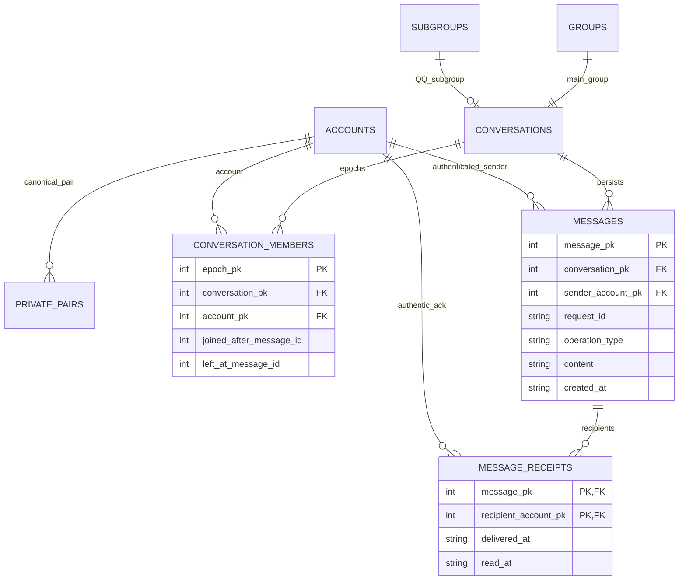

# 数据库v4：消息、回执及成员访问窗口

新增 `database/migrations/004_chat.sql`，通过MigrationV4DXX.h.in嵌入Server。保持原schema.sql及002/003增量路径，所有旧账号、好友、绑定、群及角色/子群不重建。DatabaseDXX在打开现有v1/v2/v3库时先SQLite backup+quick_check，版本对应 `.vN-backup.sqlite3`（已存在追加序号，不覆盖），再升级v4；未知非空库/未来版本拒绝。003/004各自事务，后续迁移失败不会清空数据库；v1连升若后段失败，前段已提交，可修复重试，原版本快照保留。

| 表/索引 | 主要列/不变量 |
|---|---|
| conversations | conversation_pk、service_type QQ/WECHAT、kind PRIVATE/GROUP/SUBGROUP、group_pk/subgroup_pk FK、created_at/status；GROUP每主群唯一、SUBGROUP每子群唯一 |
| private_pairs | conversation_pk、service_type、account_a/account_b FK；a<b、UNIQUE(service,a,b)，服务/好友由服务层验证 |
| conversation_members | epoch_pk、conversation_pk/account_pk FK、joined_at/left_at、joined_after_message_id/left_at_message_id；每账号会话至多一个开放窗口 |
| messages | AUTOINCREMENT message_pk、conversation_pk/sender_account_pk FK、request_id/operation_type、content/TEXT、created_at；UNIQUE(sender,request,operation)，1–4096字节 |
| message_receipts | PK(message_pk,recipient_account_pk)、delivered_at、read_at；本轮read_at始终未实现使用，不显示已读 |
| message_conversation | messages(conversation_pk,message_pk)，历史与同步 |
| message_request | messages(sender_account_pk,request_id)，重试查重 |
| conversation_member_account | conversation_members(account_pk,conversation_pk)，授权窗口 |
| receipt_recipient | message_receipts(recipient_account_pk,delivered_at)，接收者状态 |

PRIVATE双参与者由canonical pair表示，未再冗余建立participants表。MutationRepositoryDXX仍存成功结果，消息表额外主体/UUID/操作唯一约束；会话/消息/必要receipt与成功result同事务。server-only SQL、绑定参数、唯一DBworker处理；客户端不直接访问数据库或监听数据库文件变化。

## 群成员epoch

004为现有主群/原属QQ子群创建会话并为当前成员初始化窗口；无旧消息可丢。新群/QQ子群由INSERT触发器建立会话，原MVP3成员变更触发器在同一事务建立/关闭窗口。

加入时记录当前已保存全局MAX(message_pk)为joined_after；退出/踢人时记录MAX为left_at边界。合法消息满足 `message_pk > joined_after` 且（窗口未关闭或 `message_pk <= left_at_message_id`）。即使加入/退出/重入在同秒发生，ID窗口也不会混淆。重入新增epoch，不能覆盖旧窗口。父群退出的子群FK CASCADE会同步关闭子群窗口；群解散标记会话失效并关闭开放窗口，所有消息与历史窗口保留。

策略切换不删会话/消息/epoch。原属QQ子群在微信策略下禁用聊天，切回QQ恢复；群本身仍按原属服务账号发言。原属微信子群即使采用QQ管理规则也没有子群聊天会话。主群发言资格取当前成员，而不是管理角色。私聊删除好友不删除消息/会话，历史只限canonical双方，新发送重新检查好友。

## 回执与恢复

消息保存时生成实际接收者receipt，初始delivered_at为空。只有该recipient自己的认证连接、原服务激活且有对应receipt，才能ACK该message；更新持久化后再通知发送方。仅发送event或send()成功不填写delivered_at。群ACK属于具体接收者，不代表所有人。read_at保留可扩展列，本轮不收read请求。

重连查询会话、按message ID增量sync。客户端仅维护展示/游标，不用event代替数据库事实；离线消息已落库。历史before/after有界分页，不能以任意conversation ID绕过private pair或epoch权限。SQLite AUTOINCREMENT保证已提交message ID稳定且不复用，适合窗口边界。

恢复旧版本：先正常停止该库的服务器，保留当前库及WAL/SHM为完整备份；使用SQLite backup把迁移前快照恢复到**新路径**，quick_check/foreign_key_check后由对应旧版本服务器打开。不要覆盖运行中的库或混入旧WAL。旧版本不能读取v4；回到旧快照会丢弃该快照后的聊天及业务变更，因此保留当前库直到确认恢复影响。演示--reset仅作用专用mvp4-demo.sqlite3，普通启动绝不wipe。
