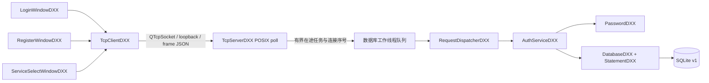
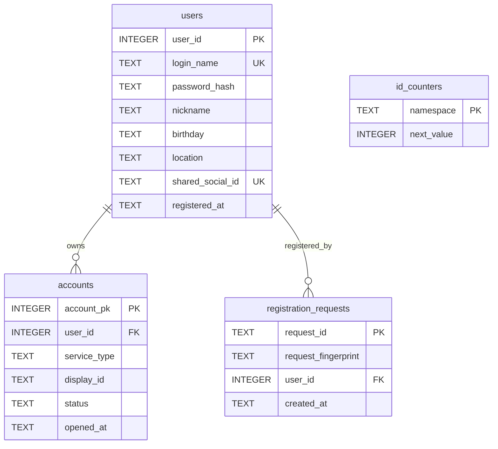

# IMPlatform MVP 1 实施报告

日期：2026-10-21（Asia/Shanghai）。本轮规格为 [MVP1_WORK_SPEC.md](MVP1_WORK_SPEC.md)，未实施后续好友、群组、聊天、多态管理、绑定等模块。原课程 `.doc` 已读取；用户明确的 Qt/POSIX/MVP1 范围优先。旧 `docs/superpowers/specs/2026-10-21-qt-chat-design.md` 为历史方案，本轮以新任务书替代其中 Qt 服务端、1 MiB 帧与聊天范围，不删除该历史文件。

## 审计与保留

本地仓库 `/Users/joyce/oop-project-Joyce` 的 origin 为用户指定的 `Joyce06joy/oop-project-joyce`。实施前 git status 干净，只有 Qt 模板：根 CMakeLists.txt、main.cpp、mainwindowdxx.h/.cpp/.ui、旧设计文档、Qt Creator/构建配置；原模板已先实际构建通过。

Mac 为 Apple Silicon arm64；Apple Clang 21.0.0；Qt 6.12.0；Qt Creator 和 Qt 自带 CMake/Ninja 已安装；json-c 0.19、OpenSSL 3.6.5、Apple SDK SQLite3 3.51.0 可用。PATH 最初没有 cmake/qmake，但官方 Qt 安装目录中的工具可用。构建未安装或升级依赖。

Git 命令行远端访问因 github.com DNS 解析失败；已连接 GitHub 工具读取仓库返回 404，可能为当前连接未获私有仓库授权，不能据此判断仓库不存在。本轮未拉取、提交或推送远端，只在已核实 origin 的本地工作树交付，不声称同步最新远端。

原 main/window/UI 源码完整保留，CMake 在原模板目标之后增量添加 MVP 1 目标。未改动 `/Users/joyce/Documents/面向对象课设` 的代码或数据库。新数据库均为新路径，未知非空库拒绝初始化。

## 完成内容与文件

| 文件/目录 | 实现职责 |
|---|---|
| CMakeLists.txt | C++17，保留旧目标，新增 IMServer / IMClient.app / 库及 CTest；内嵌 schema，无构建时下载 |
| protocol/JsonDXX.h/.cpp | json-c 的 RAII 值包装，严格 UTF-8 JSON，深拷贝确保跨线程没有共享可变树 |
| protocol/ProtocolDXX.h/.cpp | 4 字节大端 64 KiB 长度帧、半包/粘包、响应/错误信封，有界回显 |
| server/persistence/DatabaseDXX.h/.cpp | DB 线程内创建连接、外键、WAL、版本、独占锁、拒绝未知旧库 |
| server/persistence/StatementDXX.h/.cpp | SQL 预处理/参数绑定及自动释放 |
| server/application/PasswordDXX.h/.cpp | OpenSSL 随机盐、PBKDF2-HMAC-SHA256、常数时间比较、随机临时会话号 |
| server/application/AuthServiceDXX.h/.cpp | 注册校验、事务、双编号空间、幂等重放、统一密码登录、服务查询 |
| server/application/RequestDispatcherDXX.h/.cpp | 六种批准请求、连接会话、服务开通与激活校验、统一错误 |
| server/network/TcpServerDXX.h/.cpp | POSIX socket/poll、部分读写、背压、连接序号、断线、工作线程、SIGINT/SIGTERM 正常退出 |
| client/network/TcpClientDXX.h/.cpp | QTcpSocket 异步收发、请求关联、15 秒超时、重连、析构回调清理 |
| client/ui/LoginWindowDXX.h/.cpp | 状态、重连、登录、注册入口、服务页面切换 |
| client/ui/RegisterWindowDXX.h/.cpp | 字段表单、确认密码、成功 ID/复制、提交禁用、原 ID 安全重试 |
| client/ui/ServiceSelectWindowDXX.h/.cpp | 服务列表及号码、真实服务器激活、最小账号页、退出恢复 |
| client/main.cpp、server/main.cpp | 独立入口、端口/数据库参数 |
| database/schema.sql、SchemaDXX.h.in | 单一权威 v1 schema，构建生成内嵌常量 |
| tests/ | 协议、真实服务/SQLite、真实 Qt Widgets 集成测试 |
| demo/seed.py | TCP 创建三用户、显式重置专用演示库 |
| README.md、docs/ | 构建运行说明、规格、计划、协议、测试日志与报告 |

所有自定义 C++ 类均以 DXX 结尾并有独立同名 `.h/.cpp`。Qt 与 json-c 的第三方类型前置声明不属于自定义类。MVP1 不为未实现模块引入空泛类或假按钮。

## 架构与事务

UI 不读写 SQL；服务端没有 Qt 依赖，客户端没有 SQLite/OpenSSL 数据库依赖（已检查实际动态链接）。网络主线程持有 socket 和解析器，唯一数据库工作线程创建、使用并关闭 SQLite；该线程串行执行应用规则和密码 KDF。结果按连接序号返回，断线清理排入同一队列，文件描述符复用不复用旧会话。

注册在同一个 BEGIN IMMEDIATE 事务中分配计数器、写用户/选定服务/幂等记录。先查幂等记录，重放时重新验密且比较规范化字段摘要；commit 成功后才生成成功响应供网络发送，写入异常回滚。微信-only 用户 shared_social_id 为 null，为后续合法开通 QQ 保留编号语义。后续开通业务未实施。

accounts 另有 UNIQUE(user_id,service_type)、UNIQUE(service_type,display_id)；service_type/status 受 CHECK 约束，users.login_name 为 NOCASE 唯一。schema v1 空库初始化，其他版本拒绝；没有宣称实现未知旧项目迁移。

## 规格内实现选择与修复

- 使用当前已安装的 json-c 代替下载 nlohmann/json；服务端仍为纯 C++17/POSIX/SQLite/OpenSSL，无 Qt。省去网络依赖并保留可复现的包要求。
- 注册与登录页面以独立 QWidget 类复用在一个顶层登录窗口中；注册另开从属窗口，成功后的账号/服务页不制作后续模块入口。
- 未使用单独 User/Account DTO 类：本阶段服务层通过参数绑定 SQL 和有类型检查的 JSON 值传递已验证数据。推荐目录按本轮职责简化，不修改任务书的业务字段或六个协议类型。
- 非法帧关闭连接；非法请求返回错误。type/request_id 回显最长 64 字节，避免合法长度的异常请求放大错误响应。响应编码异常也在网络结果边界隔离。
- 数据库/服务器临时错误与超时都保留原注册 ID；退出遇到 AUTH_REQUIRED 回到登录页；Socket 析构先断开自身回调，防止析构期间访问已销毁成员。JSON 值深拷贝防止会话结果在跨线程间共享可变结构。这些均有回归测试。

## 验证结果与已知限制

详细 T01–T14、实际命令、失败修复历史与 Not Run 见 [TEST_REPORT.md](TEST_REPORT.md)。最终自动测试、Cocoa 原生 UI 及三个独立进程登录观察分别保留证据，不把历史失败或未运行项目标作通过。

限制：小规模本机演示，64 连接、每连接 8 个在途请求；密码 KDF 在唯一业务/数据库线程中串行，慢请求可排队但 GUI/网络不阻塞。注册未知结果的请求 ID 只在客户端内存，完全关闭客户端后不持久恢复；可先用原登录名确认结果。每个注册窗口本轮仅完成一个成功注册，另一个账号可开新客户端。尚未做跨机器、其他 Qt/macOS 版本、ASan/TSan 或性能压力验收；不声称公网安全或可独立分发的签名安装包。

MVP2 可沿已验证用户 ID、accounts、连接会话和请求分发加入开通服务与绑定；好友、群与聊天需要独立需求、数据迁移及测试。本轮在 MVP1 停止。
