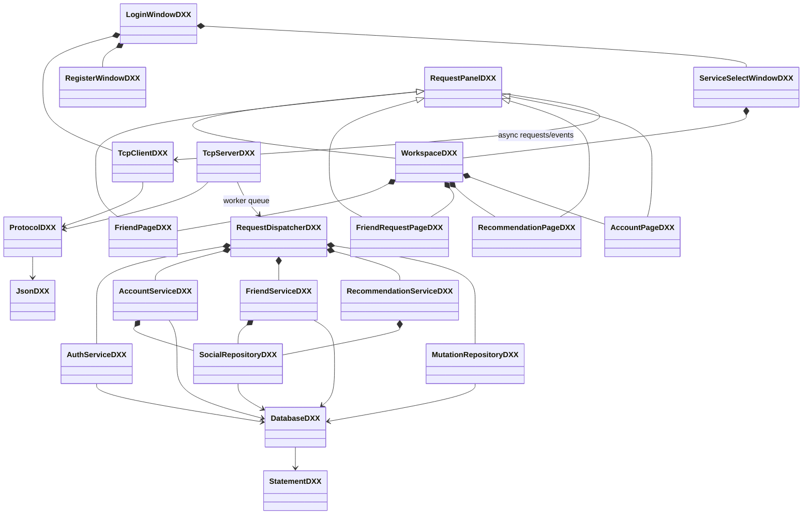
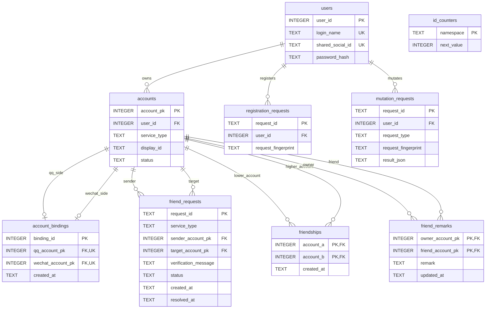
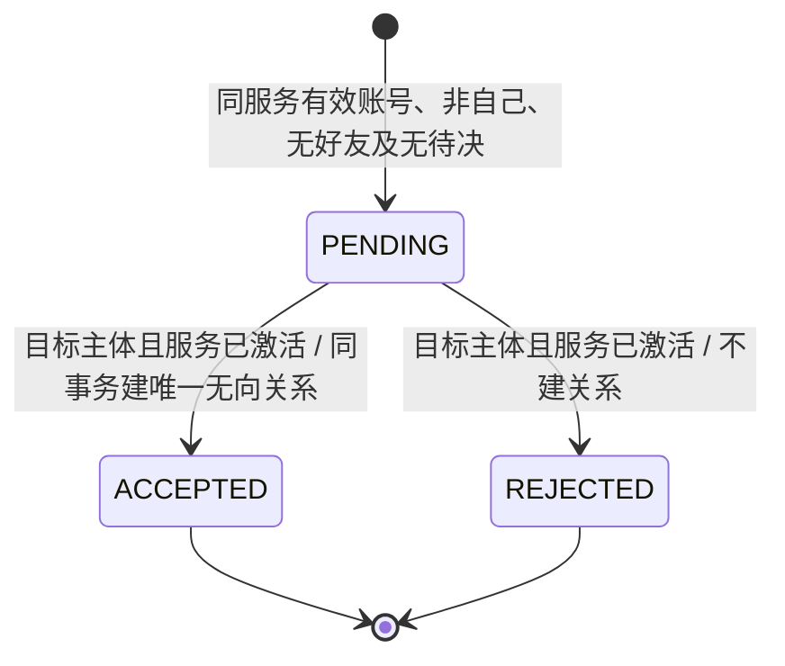
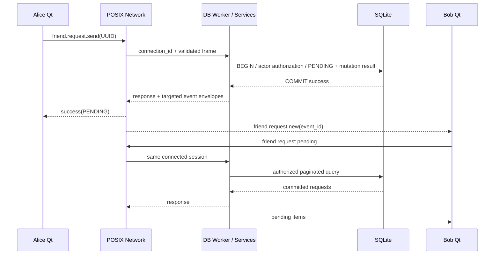

# MVP2 UML、ER 与申请状态

以下图对应本轮已实现代码；根目录旧空窗口模板MainWindowDXX仍保留，但不是本业务页面入口。没有群、策略或聊天模块。

## 实际组件与类关系

组合使用同一TcpClient与数据库连接，没有复制UI中的业务权限。RequestPanelDXX基类负责异步关联、加载、错误与未确认mutation重试；页面子类只组织输入/展示。服务端各类由工作线程创建使用；没有让网络线程执行SQL。

## 数据关系

accounts复合唯一与friend_requests部分唯一索引见[DB_SCHEMA_V2.md](DB_SCHEMA_V2.md)。friend_edges为friendships派生的只读双向视图，不是第二份关系事实。图省略未变化的基础资料字段，完整DDL以原schema与002迁移为准。

## 好友申请状态与事务

CANCELLED是数据库保留合法终态，本轮不提供撤回请求或界面。已处理申请不能再次推进；同correlation ID重试返回原结果。双向申请竞争由无序对PENDING唯一索引及串行事务确定为一个成功、另一个FRIEND_REQUEST_PENDING。

事件丢失不丢申请；离线后再次查询恢复。所有通知仅在提交后生成，幂等重放不重复产生事实或事件。WebSocket、Qt服务端替代和群聊天均不在本实现中。
