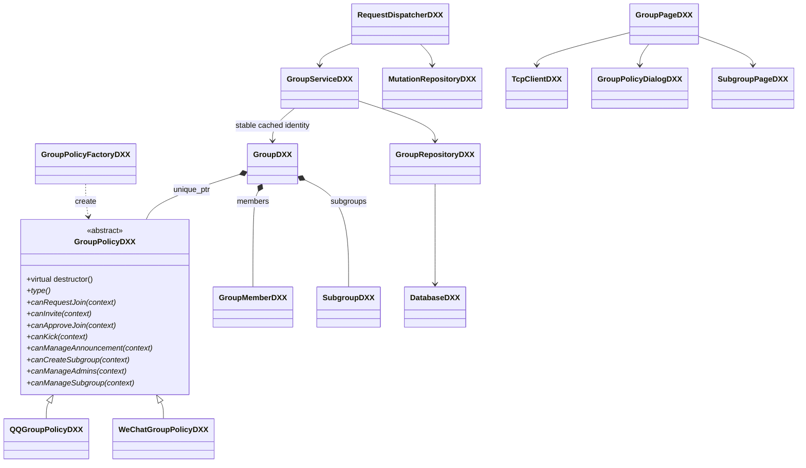
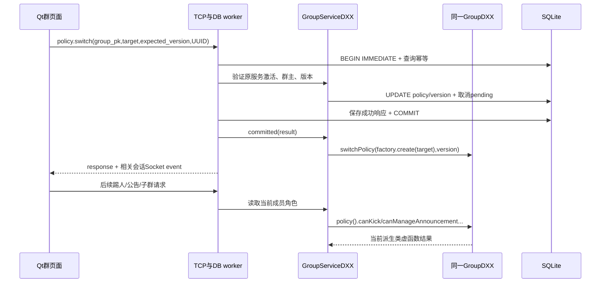
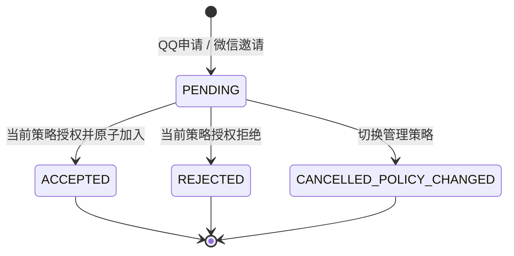

# 群组组合与动态多态

`GroupDXX`不依赖Qt/SQL。同一个Group实例组合抽象策略，经 `group.policy().canKick(context)` 等虚调用检查服务端从SQL重建的身份、目标和角色；派生策略override规则。`GroupPolicyFactoryDXX`仅负责从合法持久化类型建立策略，不把指针保存到数据库。平台归属不可改变；微信原属群切QQ策略仍使用微信账号。

`GroupServiceDXX`持有按group_pk缓存的稳定对象。修改事务开始后读取权威行、刷新成员/子群，调用虚方法；权限入口无客户端actorRole信任。类型检查用于工厂、协议流程和显示effective_role，管理权限由虚方法计算。运行时切换先提交SQL，再在同一对象替换策略；失败不替换、无通知。服务器重启从数据库工厂重建；缓存没有跨线程共享。

QQ：群主/管理员审批和公告；群主设/撤管理员、子群；管理员只踢MEMBER。微信：成员邀请，目标本人确认；仅群主管理；stored ADMIN按普通成员生效。两个策略都检查active/member，群主不可踢、不可直接退出。

请求状态机由服务事务与SQL触发器实现，未额外抽取建议性的GroupRequestDXX，以复用现有JSON仓储模式。`GroupPolicyTestsDXX`47项检查证明同一对象地址、成员/子群集合和角色保留，而切换后的虚调用结果改变并可恢复；TCP T13–T15再验证落库及重启行为。
