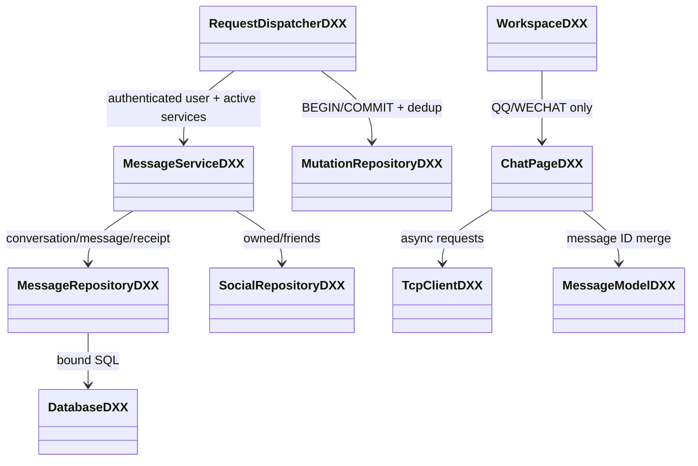
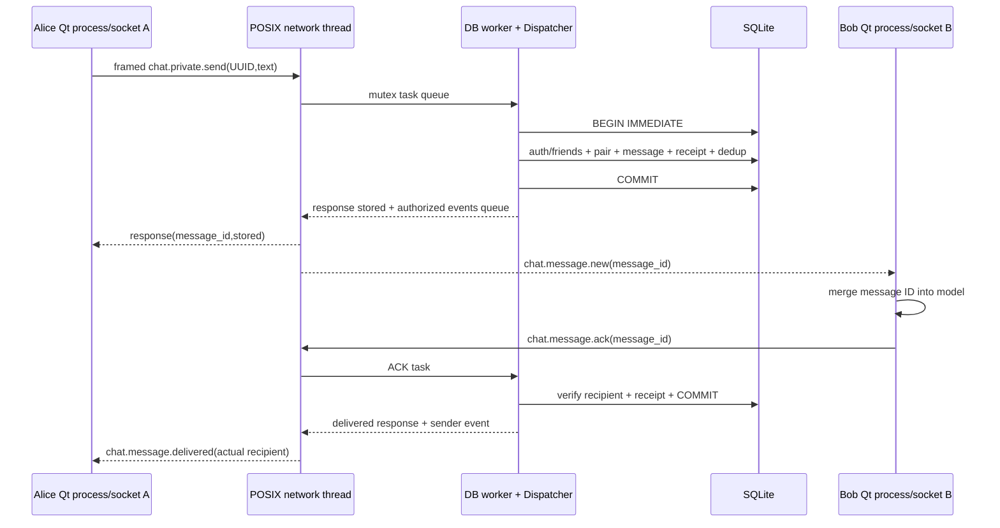
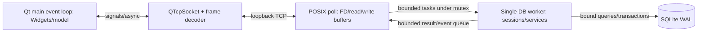
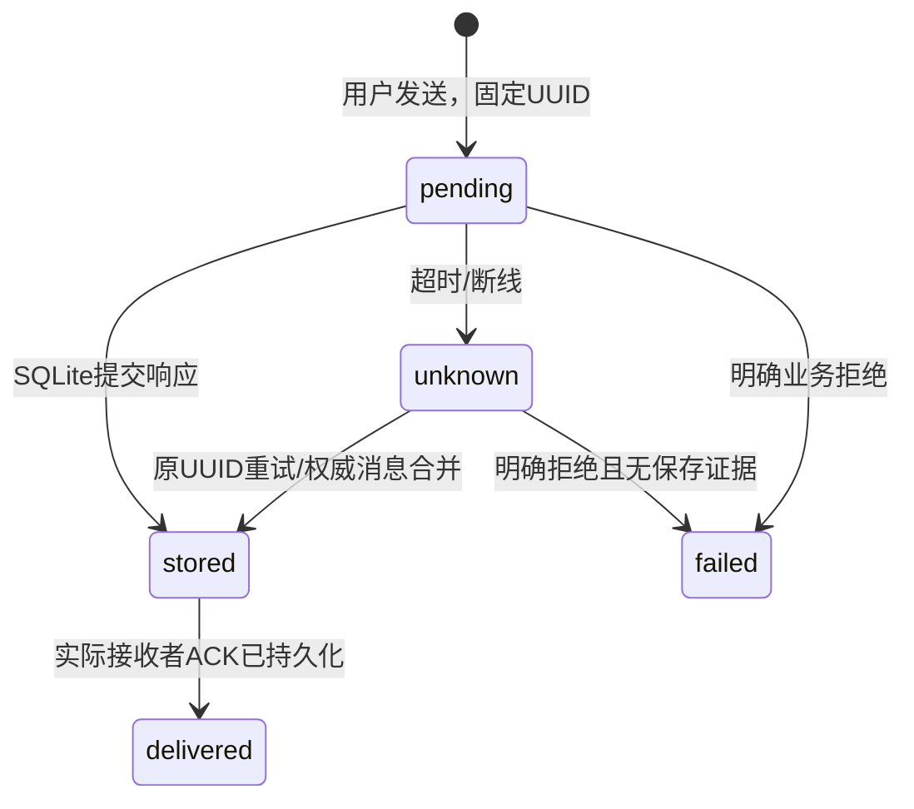

# 消息、网络与线程模型

类名以实际源码为准；已有类承担的任务不再机械拆空壳ConnectionManager/DatabaseWorker。客户端不链接SQLite，服务端不依赖Qt Widgets。群组管理策略与聊天成员资格是不同职责，不能以管理员/群主身份绕过聊天子群成员检查。

TCP send返回只说明本地缓冲已接受，不能视为送达。delivered由Bob独立ACK且服务器落库证明；没有read ACK及已读图标。Alice响应丢失重试原UUID得到原message_id，不重新推送，Bob也可由离线sync补齐。

网络线程独占FD及发送缓冲，partial sends保留未发送尾部；worker独占Database与会话，没有跨线程无锁访问socket或SQLite。结果投递不等待客户端读取；慢连接受输出上限断开，线程间队列亦需限额。退出先关闭监听与客户端、通知worker停止、处理已入队任务并join，数据库正常关闭。

UI模型按message_id稳定排序，响应和event按request_id与message_id更新同一草稿。会话切换保留未发送草稿，历史分页合并而非重复追加；回调带QObject生命周期与会话标识，重连不重复安装信号连接。自动重连与重新认证/激活的实际边界见实现报告。
